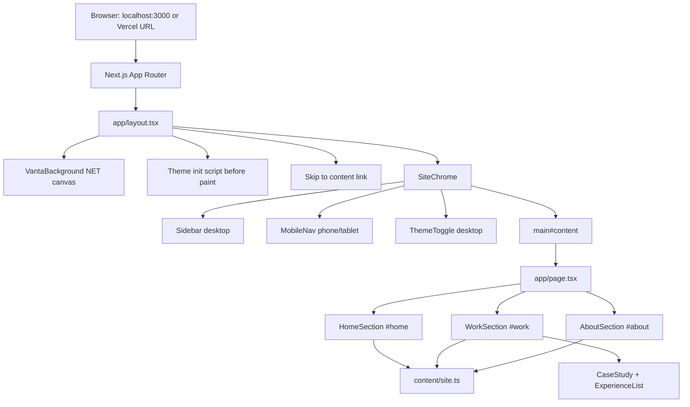
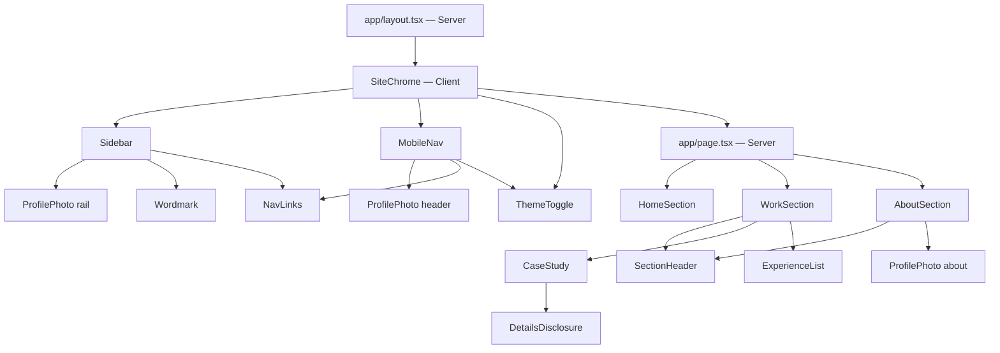
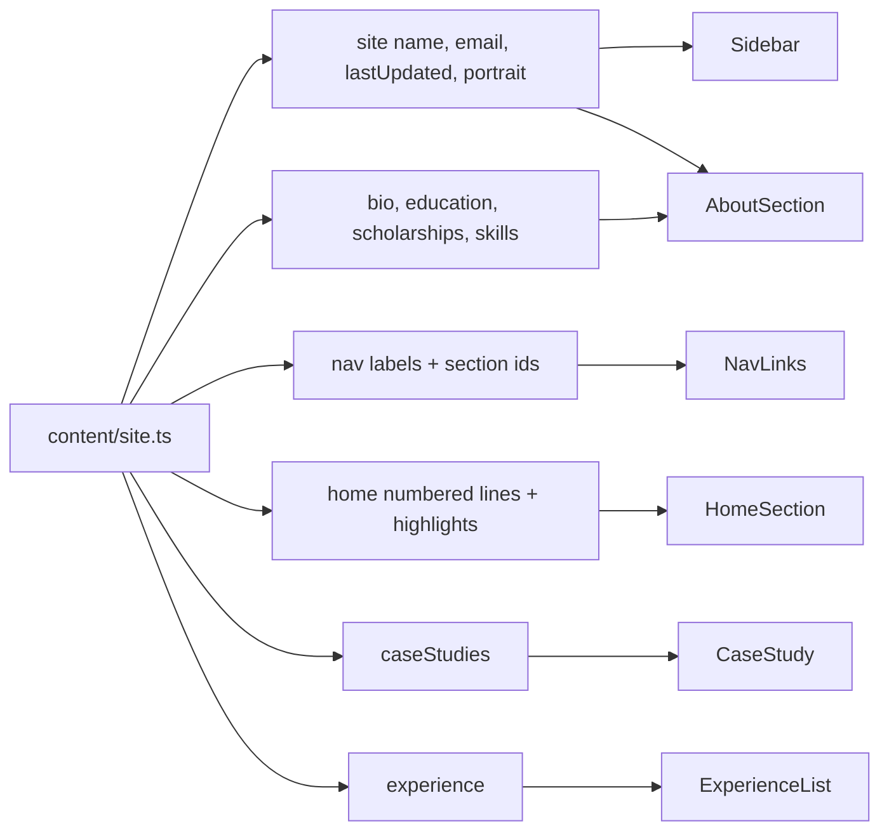
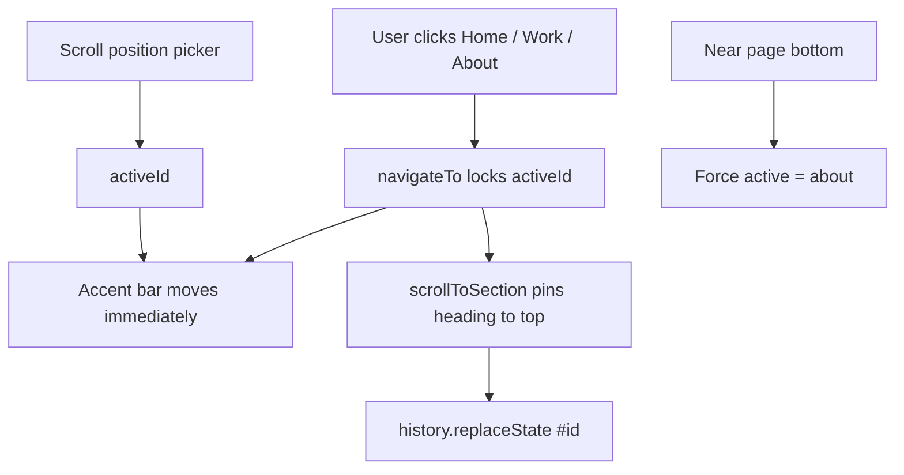
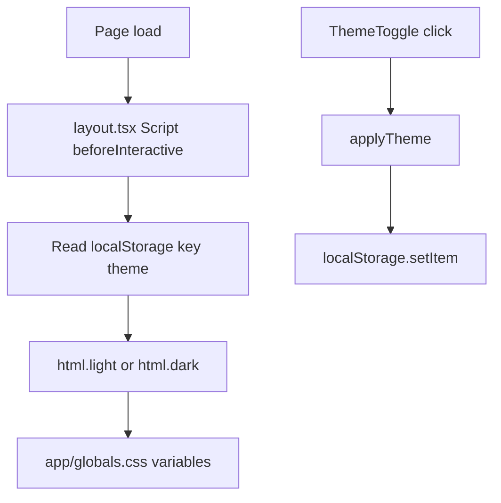
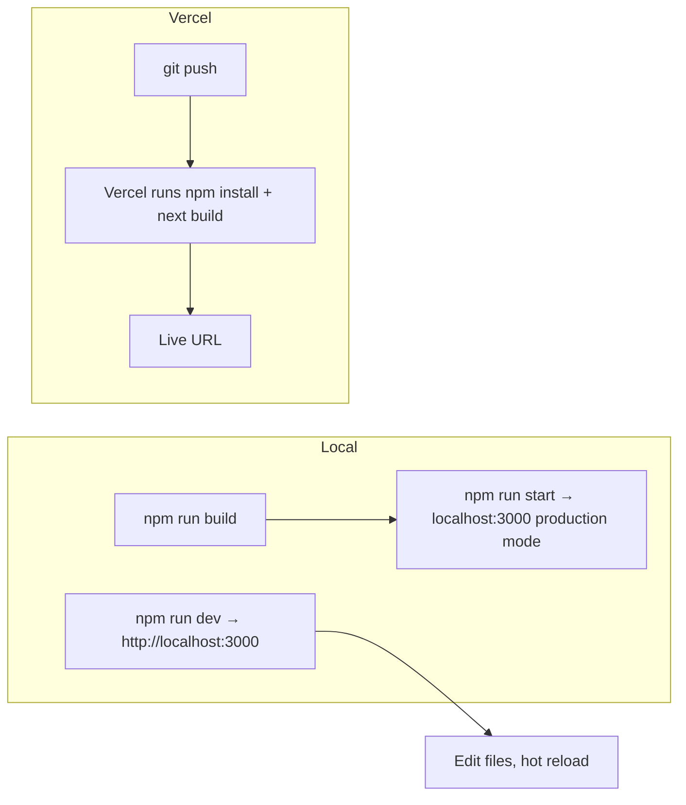
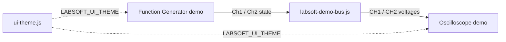

# Portfolio Website — Guide

Personal portfolio for **Jhaycee Anthony Acain**. It is a single-page Next.js site (Home, Work, About) with a desktop sidebar, a mobile menu, light/dark theme, and all copy stored in one content file.

This is **not** a multi-page site. There is one route (`/`). Navigation jumps between `#home`, `#work`, and `#about` on that page.

Keep this file in sync when source code, content, assets, scripts, or deploy setup change.

---

## Tech stack

| Piece | Version / role |
| --- | --- |
| Next.js (App Router) | `^16.3.4` |
| React | `19.2.8` |
| TypeScript | `^5` (strict) |
| Tailwind CSS | `^4` via `@tailwindcss/postcss` |
| three.js + Vanta.js NET | Animated full-page background (`vanta`, `three`) |
| Fonts | Google fonts **Syne** (display) and **Outfit** (body), loaded in `app/layout.tsx` |
| Hosting target | Vercel (Next.js default) |

**Node.js:** Next.js 16 needs **Node 20.9+**. Check with `node -v`.

There is **no database, no API routes, no auth, and no environment variables**. The site is static content rendered by Next.js.

---

## How the site works

1. The browser requests `/`.
2. Next.js renders `app/layout.tsx` (shell: fonts, theme script, skip link, chrome).
3. `app/page.tsx` fills the main column with three sections.
4. All names, bios, jobs, and project text come from `content/site.ts`.
5. Client components handle theme, the mobile drawer, and which section is active.
6. Nav links do **not** change routes. They scroll to an element `id` and update the URL hash (`#work`).

---

## Flowcharts

### Request and render



### Component tree



`"use client"` means that file (and anything it imports that needs the browser) runs in the browser. Sections like `HomeSection` stay **Server Components**: they only display data, no hooks.

### Content to UI



**Edit copy here first:** `content/site.ts`. You usually do not need to touch React files to change text.

### Navigation and active section



`useActiveSection` sets the clicked section immediately, then ignores scroll-spy until the smooth scroll ends. After that it picks the last section whose top has crossed ~28% of the viewport. Near the bottom of the page it forces **About**. This avoids Home staying highlighted when you jump down to Work.

### Theme (no flash of wrong theme)



Default is **dark** if nothing is stored. `suppressHydrationWarning` on `<html>` avoids a React warning when the script changes the class before hydration.

### Local run vs production



---

## File map: edit vs build vs ignore

### Edit these (your source)

| Path | What it is | When to edit |
| --- | --- | --- |
| `content/site.ts` | **All portfolio text and data** | Name, email, last-updated date, bio, jobs, projects, skills, nav labels |
| `app/page.tsx` | Page composition | Add/remove/reorder sections |
| `app/layout.tsx` | Root HTML, metadata, fonts, theme script, Vanta background | Title/description in Google, fonts |
| `app/globals.css` | Colors, fonts in Tailwind theme, skip-link, motion | Colors, accent, reduced-motion |
| `components/VantaBackground.tsx` | [Vanta.js NET](https://www.vantajs.com/?effect=net) full-page WebGL background | Effect settings, theme colors |
| `app/icon.svg` | Favicon (“JA”) | Branding |
| `components/SiteChrome.tsx` | Shell: sidebar + mobile nav + main offset | Overall layout |
| `components/Sidebar.tsx` | Desktop left rail (photo, nav, email, last updated) | Desktop chrome |
| `components/MobileNav.tsx` | Top bar + overlay menu | Mobile chrome |
| `components/NavLinks.tsx` | Wordmark + section links; desktop rail links are left-aligned with equal horizontal padding | Nav look/behavior |
| `components/ThemeToggle.tsx` | Sun/moon button | Theme UI |
| `components/ProfilePhoto.tsx` | Next.js `<Image>` sizes/crop | Portrait crop (`object-[center_18%]`) |
| `components/sections/SectionHeader.tsx` | Shared section title; `id` is the scroll target (`work`, `about`) | Section headings |
| `components/sections/NumberedLines.tsx` | Shared 01/02/03-style numbered line layout | Hero + positioning lines |
| `components/sections/HomeSection.tsx` | Hero (vertically centered); lines 01–03 + 04–06 | Hero layout |
| `components/sections/WorkSection.tsx` | Work section: Projects, then Work Experience | Work layout |
| `components/sections/AboutSection.tsx` | Photo, name, title, bio, education, scholarships, skills, contact | About layout |
| `components/work/CaseStudy.tsx` | One project card + Details disclosure | Project card UI |
| `components/work/DetailsDisclosure.tsx` | Animated Details +/− panel | Open/close transition |
| `components/work/ExperienceList.tsx` | Timeline list | Experience UI |
| `lib/theme.ts` | Theme helpers + `localStorage` key | Theme logic |
| `lib/scrollToSection.ts` | Scrolls the target heading to the top of the main page (clears the 56px mobile header) | Scroll behavior |
| `lib/cssColorToInt.ts` | Converts CSS `--background` / `--foreground` to Vanta hex ints | Theme-aware Vanta colors |
| `lib/useActiveSection.ts` | Scroll spy + click lock (`navigateTo`) | Active nav highlighting |
| `types/vanta.d.ts` | TypeScript types for `vanta/dist/vanta.net.min` | Vanta import typing |
| `public/jhaycee-acain.png` | 4K graduation portrait (URL `/jhaycee-acain.png`) | Replace photo; keep the same filename **or** update `site.portrait.src` |
| `public/demo/` | Live LABSoft demo pages (copy from `Demo/` after edits) | Served at `/demo/...` |
| `public/demo/ui-theme.css` / `ui-theme.js` | Shared light/dark tokens + sun/moon toggle | Demo theme look and sync |
| `public/demo/labsoft-demo-bus.js` | Shared FG state (`LABSOFT_DEMO_FG_STATE` + BroadcastChannel) | FG ↔ scope linking |
| `public/demo/labsoft-demo-preview.js` | Emits ADCS packets into Oscilloscope.js at the capture period (`N / Fs`); stopped FG channels output 0 V | Scope traces in the demo |
| `public/demo/Oscilloscope.html` (+ `.css` / `.js`) | Oscilloscope frontend demo | Scope UI |
| `public/demo/Function Generator.html` (+ `.css` / `FunctionGenerator.js`) | Two-channel FG demo: stacked Ch1/Ch2 previews, then channel controls | FG UI |
| `public/projects/` | Placeholder folder (only `.gitkeep`) | Future project screenshots |
| `package.json` | Scripts and dependencies | Adding packages |
| `next.config.ts` | Next.js config (currently empty) | Images, redirects, etc. |
| `tsconfig.json` | TypeScript; `@/*` → repo root | Path aliases |
| `postcss.config.mjs` | Tailwind 4 PostCSS plugin | CSS pipeline |
| `eslint.config.mjs` | Lint rules | Linting |
| `.gitignore` | What git should skip | Rarely |
| `Guide.md` | This document | Update when the code above changes |

Path alias: `@/content/site` means `content/site.ts` at the repo root (`tsconfig.json` `"@/*": ["./*"]`).

### Config you usually leave alone

| Path | Notes |
| --- | --- |
| `package-lock.json` | Lockfile. Commit it. Do not hand-edit. |
| `Portfolio Website.code-workspace` | VS Code/Cursor workspace file |
| `README.md` | Still the default create-next-app README |
| `AGENTS.md` / `CLAUDE.md` | Auto notes for AI agents from `next dev`. Do not treat as product docs. |
| `.cursor/rules/` | Cursor rules, including “keep Guide.md updated” |

### Build / generated — do **not** edit

These are outputs. Delete them if you want a clean rebuild; they come back on the next `dev`/`build`.

| Path | What it is |
| --- | --- |
| `.next/` | **Next.js build cache and production output.** Bundles, HTML, image optimizer cache, manifests. Never commit (already in `.gitignore`). |
| `node_modules/` | Installed packages from `npm install`. Never commit. |
| `next-env.d.ts` | Auto TypeScript types for Next. Gitignored. Header says do not edit. |
| `out/` | Only if you used static export. Not used here. |
| `build/` | Generic production folder; unused here. |
| `.vercel/` | Created if you use Vercel CLI locally. Gitignored. |
| `*.tsbuildinfo` | TypeScript incremental cache. Gitignored. |

If you “broke” the site after a bad cache: stop the server, delete `.next`, run `npm run dev` again.

### Present on disk but unused by the app

| Path | Issue |
| --- | --- |
| `public/file.svg`, `globe.svg`, `next.svg`, `vercel.svg`, `window.svg` | Leftover create-next-app assets. Not imported. |
| `Acain_CV.pdf` (repo root) | **Not in `public/`**, not linked. Visitors cannot download it. |
| `Demo/` (repo root) | Working copy of LABSoft HTML/CSS/JS. The live site serves `public/demo/`. |

---

## What each source file does

### `app/layout.tsx`

- Sets `<html lang="en">` and metadata (browser tab title + description).
- Loads Syne and Outfit as CSS variables `--font-syne` / `--font-outfit`.
- Injects a tiny **beforeInteractive** script so the saved theme applies before first paint.
- Renders skip link + `SiteChrome`.

### `app/page.tsx`

Renders three sections in order: Home → Work → About. Home is vertically centered in the first viewport (`min-h-screen` + `justify-center`, mobile `pt-32`, desktop `lg:py-24`). Work and About use `px-8 py-24` and `lg:px-16`.

### `app/globals.css`

- Tailwind 4: `@import "tailwindcss"` and `@theme inline` mapping CSS variables to utility classes (`bg-background`, `text-accent`, `font-display`, …).
- Dark/light palettes on `html.dark` / `html.light`. Light mode uses grayer `--rail`, `--card`, and `--card-hover` so content cards stand out over the Vanta background.
- Smooth scroll, skip-link, `section-enter` fade, `prefers-reduced-motion`.
- `body` keeps `--background` as fallback when Vanta is disabled (reduced motion).

### `VantaBackground`

Full-viewport [Vanta.js NET](https://www.vantajs.com/?effect=net) effect from `components/VantaBackground.tsx`, mounted in `app/layout.tsx` behind all content. Vanta uses `backgroundAlpha: 0` (transparent canvas). Net line color is `--vanta-net` (accent gold in dark mode, accent bronze in light mode). Light mode uses higher `--vanta-layer-opacity` (0.78), lower `--vanta-scrim-opacity` (0.52), and `mix-blend-mode: multiply` on the canvas so bronze lines read clearly on the cream background. The effect remounts on theme toggle so line colors refresh. Opacity tokens live in `app/globals.css`.

### `content/site.ts`

Single source of truth:

- `sectionIds` / `nav` — must stay in sync with section `id`s in the section components.
- `site` — name, title, email, lastUpdated, location, portrait path.
- `home`, `caseStudies`, `experience`, `about`.

`CaseStudy` type: `id`, `title`, `summary`, `roles` (`title` + `dates` per line), optional `demos` (`label` + `href`), `bullets`, `tech`, optional `recognition`. Lab in a Box uses two role lines (thesis and advising) and links to `/demo/Oscilloscope.html` and `/demo/Function Generator.html`.

### Client chrome (`SiteChrome` and children)

`SiteChrome` calls `useActiveSection()` once and passes `activeId` plus `navigateTo` to sidebar and mobile nav. Main content has `lg:ml-[260px]` so it clears the 260px rail on large screens. The desktop sidebar footer shows the email and `Last updated: {site.lastUpdated}`. That line is desktop-only. Store the date in `content/site.ts` as Month Day, Year (for example `September 3, 2026`).

`MobileNav` locks body scroll when open, focuses Close, and closes on Escape or overlay click.

### `ProfilePhoto`

Three variants: `rail` (112px circle, priority), `header` (36px circle, priority), `about` (14–16rem display width, `sizes` 1024–1536px for retina sharpness, lazy). Uses `next/image` with `fill`.

### Work UI

Work and About share `SectionHeader` (index, title, short intro) and `SubsectionHeading`. The `work` and `about` ids live on those headers so nav clicks pin **Work** / **About Me** to the top of the main column. Work lists **Projects** then a timeline of **Work Experience**. About leads with photo + bio, then education, a two-column scholarships/skills block, and a contact strip. `CaseStudy` shows summary, then role and dates on one row (stacked on small screens). Optional `demos` render as accent outline buttons (Lab in a Box: Oscilloscope Demo, Function Generator Demo) that open `/demo/` HTML pages in a new tab. Extra bullets live in `DetailsDisclosure` (300ms height-and-fade). `ExperienceList` is a left-rail timeline with accent dots.

LABSoft demos are static files in `public/demo/` (keep in sync with the repo-root `Demo/` folder). Next.js serves them at `/demo/Oscilloscope.html` and `/demo/Function Generator.html`. Each demo top bar starts with a **Home** button (`href="/"`) back to the portfolio. Shared `ui-theme.js` / `ui-theme.css` sync light/dark mode and the sun/moon icon across both pages (`localStorage` key `LABSOFT_UI_THEME`, plus `BroadcastChannel`). The Function Generator keeps the three-column layout: stacked Channel 1 / Channel 2 previews on the left, then Channel 1 controls, then Channel 2 controls. Both demo pages fill the browser viewport (`height: 100vh`): the Function Generator uses `--fg-scale: 1.1`, and the Oscilloscope keeps its original control layout while the plot grows to fill leftover height. `labsoft-demo-bus.js` links Function Generator Channel 1 → Oscilloscope Channel 1 and Channel 2 → Channel 2. Each FG channel has Frequency, Period, and Amplitude (peak volts, default 1 V, 0 V to 5 V in 100 mV steps, 0 V offset). The Oscilloscope demo feeds those waves through the same `ingestWebSocketFrame` path as LABSoft. `labsoft-demo-preview.js` emits ADCS packets on a capture-period timer (`N / Fs`, at most 20 Hz), not on every display frame. Stopped Function Generator channels output 0 V; press Run to drive live waveforms. Trigger Mode defaults to Auto. Dragging Trigger Level re-locks the last capture immediately. Vertical Offset redraws the traces as you step or commit the field. The scope redraws WebGL when a new packet, a resize, a zoom animation, or a live trigger-level or offset change happens. Open both pages (same browser, same origin) and press Run on a Function Generator channel to drive waveforms onto the scope. There is no hardware WebSocket or WASM in this preview.



---

## Prerequisites

1. **Node.js 20.9+** (`node -v`).
2. **npm** (comes with Node). Yarn/pnpm/bun also work if you prefer.
3. This folder as the working directory (where `package.json` lives).

---

## Install dependencies (first time, and after pulling)

In PowerShell:

```powershell
cd "F:\Lenovo Slim 5i Pro - Jhaycee\USC MS CPE-A2\Work Files\Portfolio Website"
npm install
```

This creates/updates `node_modules/` from `package-lock.json`.

---

## Run on localhost (development)

```powershell
npm run dev
```

Then open **http://localhost:3000**.

- Hot reload: save a file and the browser updates.
- Default port **3000**. If it is taken, Next prints another port (e.g. 3001).
- Stop with `Ctrl+C`.

`npm run dev` is the command you want while designing and writing copy.

---

## Build (production bundle on your machine)

```powershell
npm run build
```

This compiles the app into `.next/`. Use it to catch TypeScript/build errors **before** Vercel.

Optional checks:

```powershell
npm run lint
```

---

## Run the production build on localhost

After a successful `npm run build`:

```powershell
npm run start
```

This serves the **production** build at **http://localhost:3000** (no hot reload). This is closer to what Vercel ships than `npm run dev`.

| Script | Command | Use |
| --- | --- | --- |
| `dev` | `next dev` | Daily work, localhost, hot reload |
| `build` | `next build` | Compile for production |
| `start` | `next start` | Serve that build locally |
| `lint` | `eslint` | Lint |

---

## Git versioning (local)

This folder **is already a Git repository**. You do not need `git init` again. There is one older commit from Create Next App (`55daa94`); your portfolio work is ready to save as new commits.

### What Git tracks vs ignores

| Tracked (safe to commit) | Ignored automatically (`.gitignore`) |
| --- | --- |
| `app/`, `components/`, `content/`, `lib/`, `types/` | `.next/` build output |
| `public/jhaycee-acain.png`, `Guide.md`, `package.json` | `node_modules/` |
| `package-lock.json`, config files | `.env*` secrets |
| `.cursor/rules/` (optional project rules) | `.vercel/` |

Large files at the repo root (`Grad Pic*.jpg/png`, `Acain_CV.pdf`) are **not** ignored — Git will include them if you run `git add .`. Remove them from the commit with `git restore --staged <file>` if you only want the live site files.

### Daily workflow

Open PowerShell in this folder:

```powershell
cd "F:\Lenovo Slim 5i Pro - Jhaycee\USC MS CPE-A2\Work Files\Portfolio Website"
git status
git add .
git commit -m "Describe what you changed."
git log --oneline -5
```

Example messages:

```text
Add Vanta NET background and About section updates.
Update Work section layout and case study roles.
Fix light mode card contrast.
```

### First portfolio commit (when you are ready)

Your working tree currently has many new and modified files. When you want to save everything:

```powershell
git add .
git status
git commit -m "Build personal portfolio: sections, content, Vanta background, and Guide."
```

Review `git status` before committing. Do **not** commit `.env` files if you add secrets later.

### Optional: GitHub remote

Local Git works without GitHub. To back up online or deploy with Vercel, create a repo on GitHub, then:

```powershell
git remote add origin https://github.com/YOUR_USERNAME/YOUR_REPO.git
git branch -M main
git push -u origin main
```

Check remotes: `git remote -v`.

---

## Deploy to Vercel (recommended: Git)

This app has **no env vars**, so import + deploy is enough once the repo is on GitHub/GitLab/Bitbucket.

### A. Put the project on GitHub

1. Confirm you are in the project folder (`package.json` visible).
2. Commit source (not `.next/` or `node_modules/` — `.gitignore` already excludes them).
3. Create a GitHub repo and push `main` (or `master`).

Example after you have a GitHub repo URL:

```powershell
git add .
git status
git commit -m "Add portfolio site."
git remote add origin https://github.com/YOUR_USERNAME/YOUR_REPO.git
git branch -M main
git push -u origin main
```

Do **not** commit secrets. This project currently has none.

Include `public/jhaycee-acain.png` in the commit or the live site will have a broken portrait.

### B. Import in Vercel

1. Sign up / log in at [https://vercel.com](https://vercel.com) with the same Git account.
2. **Add New → Project**.
3. Import the repository.
4. Confirm auto-detected settings:

   | Setting | Expected value |
   | --- | --- |
   | Framework Preset | Next.js |
   | Root Directory | `./` (repo root) |
   | Build Command | `next build` (or `npm run build`) |
   | Install Command | `npm install` |
   | Output | leave default (Vercel handles `.next`) |
   | Node.js | 20.x or 22.x |

5. Environment variables: **none required**.
6. Click **Deploy**.
7. Open the `*.vercel.app` URL. Check Home / Work / About, theme toggle, mobile menu, and the portrait.

Later pushes to the production branch auto-deploy. Pull requests get preview URLs.

### C. Custom domain (optional)

Vercel → Project → **Settings → Domains** → add `yourdomain.com` → follow DNS instructions.

### D. Alternative: Vercel CLI (no Git)

```powershell
npm i -g vercel
vercel login
vercel
```

Follow the prompts. Git-connected deploys are easier for ongoing updates.

---

## What you might be missing

### Content and assets

- **CV is not on the site.** `Acain_CV.pdf` sits at the repo root. To make it downloadable, put it in `public/` (e.g. `public/Acain_CV.pdf`) and add a link (`href="/Acain_CV.pdf"`) in About or the sidebar. Files outside `public/` are not served.
- **LABSoft demos** are served from `public/demo/`. Keep that folder in sync with edits in the root `Demo/` folder. Theme is shared via `LABSOFT_UI_THEME`. Function Generator has two channels with stacked left-column previews and per-channel Amplitude; they drive Oscilloscope CH1/CH2 through `labsoft-demo-bus.js`. Both demo pages fill the browser viewport and have a **Home** link back to `/`. The Oscilloscope software trigger (Auto by default) keeps those traces stable; dragging Trigger Level re-locks the last capture immediately, and Vertical Offset redraws the traces as you adjust it. The preview stream keeps the Oscilloscope display alive at all times; stopped FG channels show 0 V until you press Run.
- **`public/projects/` is empty.** Case studies are text-only except Lab in a Box demo links. Screenshots would go here and need new fields/UI in `CaseStudy`.
- **No GitHub, LinkedIn, or other social links** in `content/site.ts`.
- **Leftover starter SVGs** in `public/` can be deleted once you confirm nothing references them.

### SEO and sharing

- Metadata is only `title` and `description`. There is no Open Graph image, Twitter card, `sitemap.ts`, or `robots.ts`. LinkedIn/iMessage previews will be plain.
- `app/icon.svg` is the tab icon; a dedicated `opengraph-image` would improve sharing.

### Git / deploy readiness

- Uncommitted local files are **not** on Vercel. Commit and push source (including `public/jhaycee-acain.png`).
- Confirm a **remote** exists (`git remote -v`) before the Vercel Git import.
- Commit `package-lock.json` so Vercel installs the same versions you tested.

### Product gaps (optional, not bugs)

- Single page only — no `/blog`, no per-project routes.
- Email is `mailto:` only — no contact form.
- No tests.
- `next.config.ts` is empty — fine until you need image domains, redirects, or `output: "export"`.
- Accessibility is started (skip link, `aria-*`, focus rings, reduced motion) but the mobile menu is not a full focus trap.

### Local/dev gotchas

- Portrait path is `/jhaycee-acain.png` → file must be `public/jhaycee-acain.png`.
- If you add a nav item, update **all** of: `sectionIds`, `nav` in `content/site.ts`, a section component with matching `id`, and `app/page.tsx`.
- `npm run start` without `npm run build` first will fail or serve a stale build.
- Do not commit `.next/`. If it was committed by mistake, remove it from git and keep it gitignored.

### Windows

- Prefer `npm run dev` from the folder that contains `package.json`.
- If `next` is not found, run `npm install` again.

---

## Quick “I want to change X”

| Goal | Where |
| --- | --- |
| Change name, email, tagline, last-updated date | `content/site.ts` → `site` |
| Change hero sentences | `content/site.ts` → `home.numbered` |
| Change hero positioning paragraph | `content/site.ts` → `home.positioning` |
| Add a project | `content/site.ts` → `caseStudies` |
| Change Lab in a Box demo links | `content/site.ts` → `caseStudies[0].demos`; HTML/CSS/JS in `public/demo/` |
| Edit Oscilloscope / Function Generator demos | Edit `Demo/`, then copy into `public/demo/` |
| Function Generator 1920×1080 scale | `public/demo/Function Generator.css` → `--fg-scale` |
| Oscilloscope viewport fill | `public/demo/Oscilloscope.css` → `.parent` `100vh` grid; plot is flex `1fr` |
| Function Generator amplitude | `Demo/Function Generator.html` Amplitude fields (0 V–5 V, 100 mV steps); `FunctionGenerator.js` |
| Function Generator preview window | `Demo/FunctionGenerator.js` → `PREVIEW_WINDOW_MIN_SEC` (default 35 ms) |
| Demo light/dark or sun/moon icon | `public/demo/ui-theme.css` and `ui-theme.js` |
| FG → scope channel linking | `public/demo/labsoft-demo-bus.js` and `labsoft-demo-preview.js` |
| Oscilloscope software trigger | `public/demo/Oscilloscope.html` Trigger Mode (default Auto); preview packets go through `ingestWebSocketFrame` |
| Oscilloscope Trigger Level drag | `Demo/Oscilloscope.js` `applyLiveTriggerLevel` re-ingests the last frame while dragging |
| Oscilloscope Vertical Offset | `Demo/Oscilloscope.js` `applyLiveVerticalOffset` remaps and redraws the last traces immediately |
| Oscilloscope Stop + 0 s offset | `Demo/Oscilloscope.js` `getDisplayedMarkerFraction` keeps the time-0 marker centered when Horizontal Offset is 0 s |
| Oscilloscope demo sampling rate | `Demo/Oscilloscope.js` `applyStreamAcquisition` skips `location.reload` in demo preview so offsets persist |
| Demo Home button | `Demo/Oscilloscope.html` and `Demo/Function Generator.html` first `.menu1` link (`href="/"`); same style as Oscilloscope / Function Generator |
| Add a job | `content/site.ts` → `experience` |
| Change bio / education / skills | `content/site.ts` → `about` |
| Rename a nav tab | `content/site.ts` → `nav` (keep `id` in sync with the section); desktop alignment in `components/NavLinks.tsx` |
| Replace portrait | `public/jhaycee-acain.png` or `site.portrait` |
| Colors | `app/globals.css` (`--accent`, `--background`, …) |
| Tab title | `app/layout.tsx` → `metadata` |
| Favicon | `app/icon.svg` |
| Change Vanta NET settings | `components/VantaBackground.tsx` → `VANTA_NET` |
| Change Vanta visibility | `app/globals.css` → `--vanta-layer-opacity`, `--vanta-scrim-opacity`, `--vanta-net` |
| Crop of the photo | `components/ProfilePhoto.tsx` `object-[...]` classes |

---

## Architecture summary

```
Portfolio Website/
├── app/                    ← Next.js routes (edit)
│   ├── layout.tsx          ← HTML shell
│   ├── page.tsx            ← /
│   ├── globals.css         ← theme + Tailwind
│   └── icon.svg            ← favicon
├── components/             ← UI + VantaBackground (edit)
├── content/site.ts         ← ALL COPY (edit first)
├── lib/                    ← theme, scroll, scroll-spy, cssColorToInt (edit)
├── types/vanta.d.ts        ← Vanta TypeScript types
├── public/                 ← static files at site root (edit assets)
│   └── demo/               ← LABSoft Oscilloscope + Function Generator demos
├── Demo/                   ← working copy of the demos (copy into public/demo/)
├── .next/                  ← BUILD OUTPUT (do not edit)
├── node_modules/           ← dependencies (do not edit)
├── package.json            ← scripts + deps
├── next.config.ts          ← Next config
└── Guide.md                ← this guide (keep in sync with code)
```

That is the whole app: one layout (with Vanta NET background), one page, three sections, chrome around them, and a content module feeding every string.
